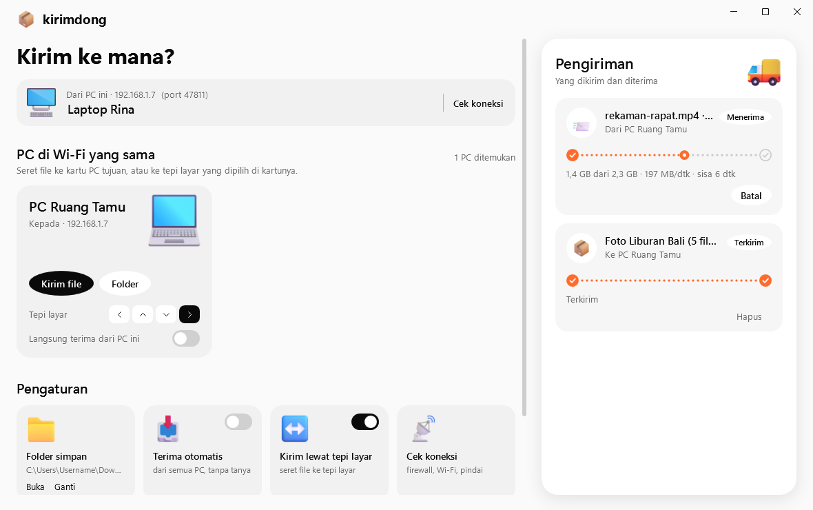
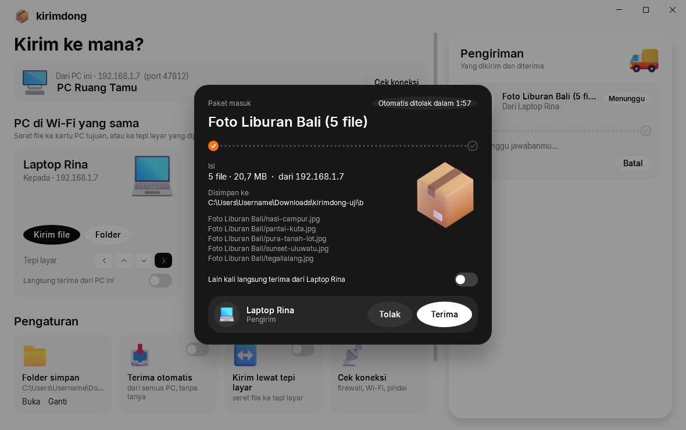
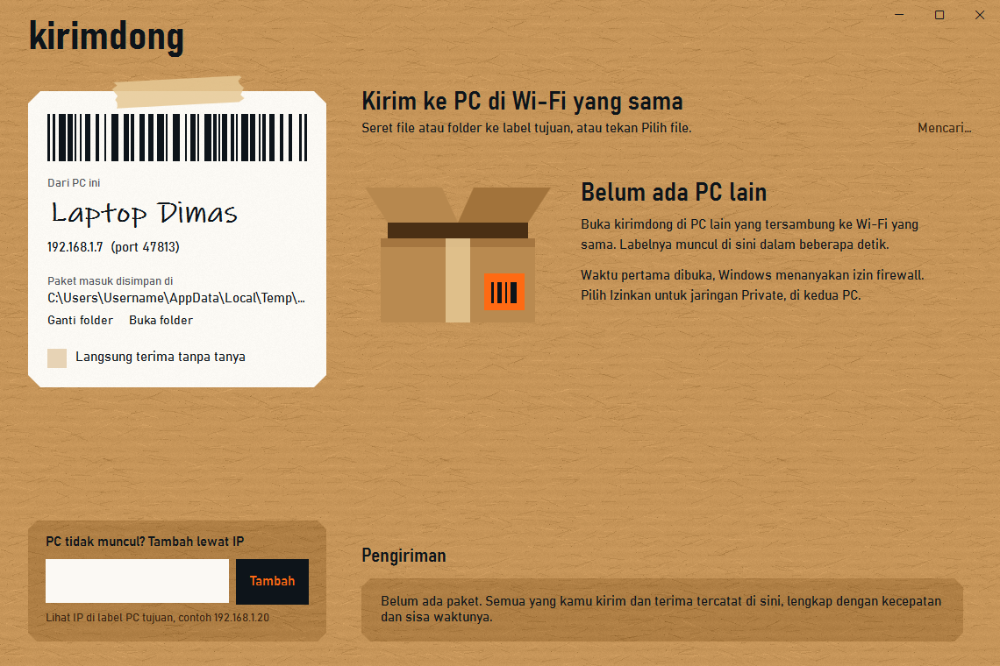
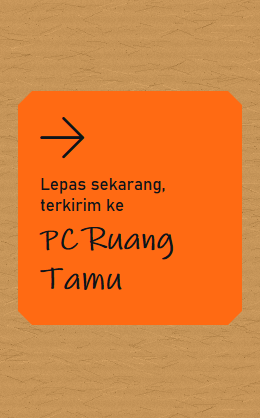
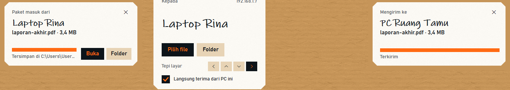
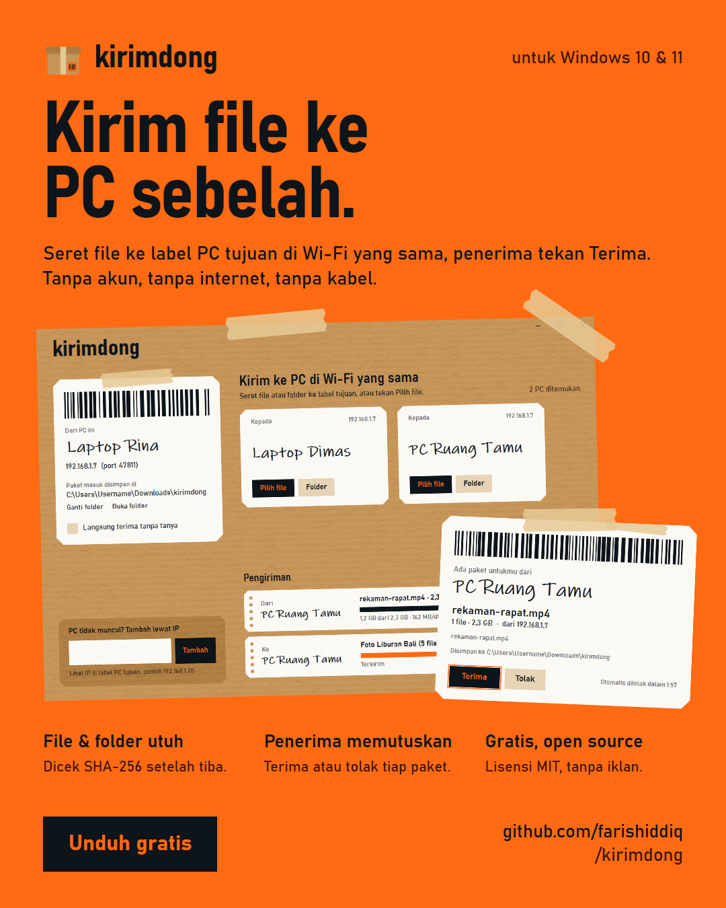

# kirimdong

**Kirim file antar PC Windows di Wi-Fi yang sama.** Buka kirimdong di dua PC, labelnya saling muncul,
seret file ke label tujuan, PC penerima menekan **Terima**. Tanpa akun, tanpa internet, tanpa kabel,
tanpa upload ke cloud.

Tampilannya dibuat seperti kardus paket: tiap PC adalah label pengiriman, tiap transfer adalah slip yang
mencatat kecepatan dan sisa waktunya.

**Baru di 1.1:** seret file ke **tepi layar** yang mengarah ke laptop sebelah, lepas, dan file muncul di
layar laptop itu. Ditambah **Cek koneksi** yang memperbaiki penyebab paling umum dua laptop tidak saling
ketemu (firewall Windows) dengan sekali klik, pencarian cadangan lewat pindai jaringan, dan transfer yang
lebih cepat.

**Download:** [rilis terbaru](https://github.com/farishiddiq/kirimdong/releases/latest) (`kirimdong-<versi>-win-x64.msi`)

## Screenshots

Laptop Rina melihat dua PC lain di Wi-Fi yang sama. Folder foto sudah terkirim, rekaman rapat 2,3 GB sedang masuk.



Paket masuk selalu ditanyakan dulu: siapa pengirimnya, isinya apa, berapa besar, dan disimpan ke mana.



Belum ada PC lain yang terbuka:



Seret file sampai tepi kanan layar: portal kirimdong terbuka di sana. Lepas, dan file terbang ke PC di sebelah
kanan. Di laptop penerima, kartu paket masuk dari tepi yang berlawanan.




<p align="center">
  
</p>

## Fitur

- **Kirim lewat tepi layar.** Di label tiap PC, pilih tepi layarmu yang mengarah ke PC itu (kiri, atas, bawah,
  kanan; PC pertama otomatis di kanan). Seret file dari Explorer, desktop, atau browser sampai menyentuh tepi
  itu, portal terbuka, lepas, terkirim. Laptop penerima menampilkan kartu kedatangan dari tepi yang berlawanan,
  lengkap dengan **Buka** dan **Folder**.
- **PC yang dipercaya.** Centang *Langsung terima dari PC ini* di label PC itu (atau di kartu paket masuk), dan
  kirimannya tersimpan tanpa kartu Terima/Tolak. Ini yang membuat portal terasa mulus antar laptop milik sendiri.
- **Cek koneksi.** Membaca jenis jaringan (Public/Private), kecepatan link Wi-Fi, dan aturan firewall Windows
  untuk kirimdong. Kalau firewall menahan kiriman masuk, banner oranye muncul dan tombol **Izinkan** memasang
  aturan firewall (Windows meminta izin admin sekali).
- **Otomatis saling menemukan.** PC yang membuka kirimdong di jaringan yang sama muncul sebagai label dalam
  beberapa detik (broadcast UDP di jaringan lokal), dan hilang lagi saat app-nya ditutup. Kalau broadcast tidak
  tembus, kirimdong memindai jaringan (subnet sampai /22) lewat TCP, dan PC yang dihubungi ikut mengenali
  pengirimnya.
- **File dan folder.** Seret ke label, atau pakai **Pilih file** / **Folder**. Isi folder dikirim lengkap
  dengan susunan subfoldernya, termasuk folder kosong.
- **Penerima yang memutuskan.** Setiap paket menampilkan pengirim, daftar file, ukuran, dan folder simpan,
  lalu menunggu **Terima** atau **Tolak** (otomatis ditolak setelah 2 menit). Opsi **Langsung terima tanpa
  tanya** tersedia untuk PC milik sendiri.
- **Diperiksa sampai utuh.** Setiap file dicek dengan SHA-256 setelah tiba. File yang rusak di jalan ditolak,
  dan file setengah jadi (`.kdpart`) dihapus kalau transfer batal atau putus.
- **Cepat.** Disk dan jaringan bekerja bersamaan (blok berikutnya dibaca selagi blok sekarang dikirim), file
  tujuan dialokasikan sekali di awal, buffer socket 4 MB. Uji loopback 768 MB: 253–279 MB/dtk (1.0: 83–200 MB/dtk).
  Lewat Wi-Fi, batasnya adalah Wi-Fi itu sendiri; Cek koneksi menunjukkan perkiraannya.
- **Tidak menimpa apa pun.** Nama yang sudah ada diberi nomor: `foto.jpg` → `foto (1).jpg`, `Album` → `Album (1)`.
- **Slip pengiriman**: progres, kecepatan, sisa waktu, tombol **Batal**, dan **Buka** untuk melihat hasilnya
  di Explorer.
- **Tambah lewat IP** untuk jaringan yang memblokir broadcast (misalnya Wi-Fi kantor atau hotel).
- **Nama PC bisa diganti** langsung di label sendiri; PC lain melihat nama baru seketika.

## Cara install

1. Download `kirimdong-<versi>-win-x64.msi` dari [halaman rilis](https://github.com/farishiddiq/kirimdong/releases/latest).
2. Jalankan. Terinstal untuk akun kamu saja (tidak perlu hak administrator), lengkap dengan shortcut Start Menu
   dan Desktop. Runtime .NET sudah termasuk.
3. Lakukan di **kedua** PC.

> Installer belum ditandatangani (code signing), jadi Windows SmartScreen bisa menampilkan
> "Windows protected your PC". Pilih **More info → Run anyway**.

Uninstall lewat **Settings → Apps → Installed apps**. Pengaturan di `%APPDATA%\kirimdong` dan file yang
sudah diterima tidak ikut terhapus.

## Cara pakai

1. Buka **kirimdong** di dua PC yang tersambung ke Wi-Fi (atau router) yang sama.
2. Kalau muncul banner oranye *PC lain belum bisa menghubungi PC ini*, tekan **Izinkan** dan pilih **Ya** di
   jendela izin Windows. Lakukan di **kedua** PC. (Windows 11 mencatat Wi-Fi rumah sebagai *Public* secara
   bawaan, dan di jaringan Public firewall menolak kiriman masuk ke app yang belum diizinkan. Ini penyebab paling
   umum dua laptop tidak saling ketemu.)
3. Label PC lain muncul di kanan. Seret file/folder ke labelnya, ke tepi layar yang dipilih di labelnya, atau
   tekan **Pilih file**.
4. Di PC penerima, tekan **Terima** (atau centang *Langsung terima dari PC ini*). File masuk ke
   `Downloads\kirimdong` (bisa diganti lewat **Ganti folder**).

### Kalau tetap tidak ketemu

1. Tekan **Cek koneksi** (kiri bawah) di **kedua** PC. Firewall harus berbunyi *diizinkan* di keduanya.
2. Tekan **Pindai jaringan sekarang**.
3. Masih kosong: router kemungkinan memisahkan perangkat (*client isolation*, umum di Wi-Fi tamu, kantor,
   kampus). Nyalakan **Mobile hotspot** di salah satu laptop (Settings → Network & internet → Mobile hotspot)
   dan sambungkan laptop lain ke hotspot itu.
4. Atau ketik IP PC tujuan (tertulis di labelnya) di **Tambah lewat IP**.

## Privasi dan keamanan

- Semua lewat jaringan lokal kamu. Tidak ada server, akun, iklan, atau telemetri; app ini tidak menghubungi internet.
- Yang dikirim ke jaringan saat app terbuka: nama PC (yang tertulis di label) dan port penerima, supaya PC lain bisa menemukannya.
- Paket dari PC lain tidak disimpan sebelum kamu menekan **Terima**, kecuali dari PC yang kamu centang
  *Langsung terima*, atau kalau *Terima dari semua PC tanpa tanya* menyala. PC dikenali dari ID perangkatnya,
  yang belum diverifikasi secara kriptografis: orang lain di jaringan yang sama bisa menyamar. Paket hanya
  disimpan ke folder simpan, tidak pernah dijalankan.
- Tombol **Izinkan** memasang dua aturan firewall masuk bernama *kirimdong* (TCP dan UDP, khusus untuk
  `kirimdong.exe`, semua jenis jaringan), dan mematikan aturan lama yang memblokir kirimdong. Aturan ini tetap ada
  setelah uninstall; hapus lewat *Windows Defender Firewall → Advanced settings → Inbound Rules*.
- Portal tepi layar hanya membaca posisi kursor dan status tombol mouse (tanpa hook global), dan tidak pernah
  mengambil fokus dari app yang sedang kamu pakai.
- Nama file dari PC lain dibersihkan sebelum disimpan, sehingga file tidak bisa keluar dari folder simpan (`..\`, path absolut, nama perangkat Windows).
- Pengaturan tersimpan di `%APPDATA%\kirimdong\settings.json`.

## Keterbatasan

- **Belum terenkripsi.** Isi file berjalan di jaringan lokal tanpa enkripsi. Aman untuk Wi-Fi rumah atau kantor
  yang kamu percaya; jangan dipakai untuk file sensitif di Wi-Fi publik.
- Hanya Windows 10/11 (64-bit). Belum ada versi Android/macOS.
- Pencarian otomatis hanya di satu subnet. Router yang memisahkan perangkat (*client isolation*, umum di Wi-Fi
  tamu) memblokir koneksi antar-PC sama sekali.
- Transfer yang putus harus diulang dari awal (belum bisa dilanjutkan).
- Kecepatan mengikuti jaringan: antar dua laptop di satu access point, setiap byte lewat udara dua kali.
  Contoh: link Wi-Fi 144 Mbps berarti sekitar 5 MB/dtk; 5 GHz dekat router atau kabel LAN jauh lebih cepat.
- Portal tepi layar bukan berbagi mouse: kursor tidak pindah ke laptop sebelah. File dilepas di tepi layar
  pengirim, lalu muncul sebagai kartu di layar penerima.
- Path file yang lebih panjang dari 259 karakter tidak terbaca saat di-drag-and-drop (batas format drag-drop
  Windows yang dipakai WPF); pakai **Pilih file** untuk file seperti itu.

## Teknologi

- C# / .NET 8, WPF (tanpa library pihak ketiga). Font bawaan Windows: Bahnschrift dan Ink Free.
- `Kirimdong.Core`: discovery UDP (port 47800) plus pindai TCP sebagai cadangan, transfer TCP (port 47801)
  dengan protokol sederhana (header `KDNG`, penawaran JSON, aliran byte per file + SHA-256), salin double-buffer,
  pembersihan path.
- `Kirimdong.App`: UI kardus, label, slip, kartu paket masuk, portal tepi layar (jendela non-aktif di tepi
  layar), kartu kedatangan, dan cek koneksi (API COM Windows: Network List Manager dan Windows Firewall).
  Tekstur kraft digambar sendiri saat start.
- Installer: MSI per-user dengan WiX Toolset 5.

### Build dari source

```powershell
dotnet test tests/Kirimdong.Core.Tests --filter "Category!=Benchmark"   # 45 test: protokol, path, discovery, transfer lewat socket sungguhan
dotnet test tests/Kirimdong.Core.Tests -c Release --filter Category=Benchmark --logger "console;verbosity=detailed"   # kecepatan loopback
dotnet run --project src/Kirimdong.App
powershell -ExecutionPolicy Bypass -File installer/build.ps1   # → artifacts/kirimdong-<versi>-win-x64.msi
```

Menguji dua salinan di satu PC: `kirimdong.exe --profile a --port 47811` dan `kirimdong.exe --profile b --port 47812`
(pengaturan dan kunci single-instance terpisah per profil).

## Lisensi

[MIT](LICENSE) © 2026 farishiddiq
